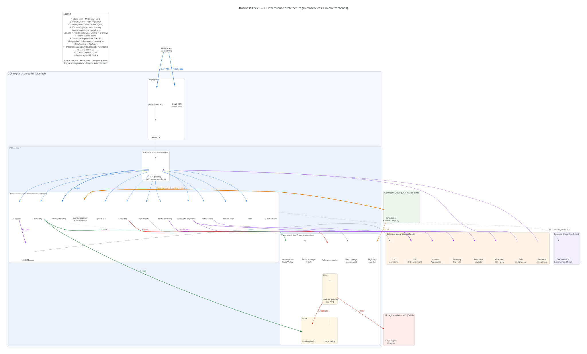
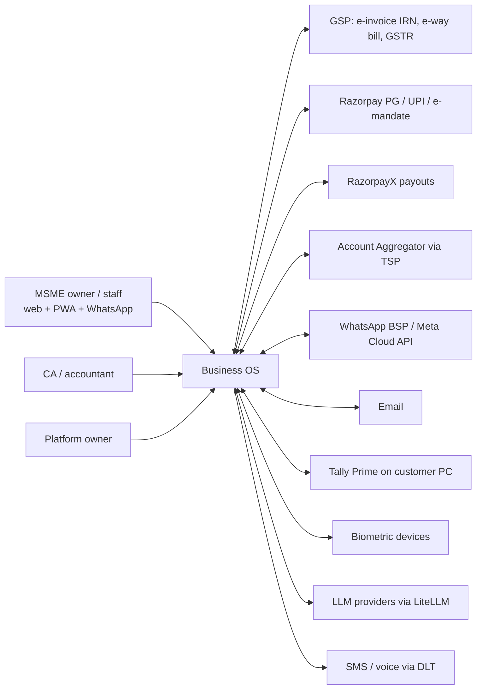

# Architecture overview



PNG: [diagrams/business-os-architecture.png](diagrams/business-os-architecture.png) · Editable: [diagrams/business-os.drawio](diagrams/business-os.drawio) (open in diagrams.net)

## 0. Verdict (rev 2: microservices + micro frontends from day one)

On paper only: nothing is provisioned by this document. It must not block story work; stories can start against the OpenAPI mocks in W2.

1. **No monolith of any kind.** 11 domain microservices on Cloud Run (scale to zero) behind an API gateway, plus a shell app with one micro frontend (MFE) per module and a shared design system `@bos/ui`.
2. **Each service owns its data**: its own tables (own Postgres schema + DB user) on a shared Cloud SQL instance, shared-table RLS by tenant_id, no cross-service joins. Services call each other only via /v1 APIs through the gateway or via events.
3. **Contract-first**: OpenAPI per service + an event schema registry (JSON Schema, versioned) in a contracts repo. Async via a per-service transactional outbox → Kafka (Confluent Cloud).
4. **Tenancy is routing, not a fork**: tenant catalog (owned by identity/tenancy) maps tenant → tier (shared / schema / dedicated). Same code and migrations on every tier.
5. **Per-service CI/CD and OTel → Grafana LGTM**, with blocking tenant-leak, contract and secret-scan gates. Sentry dropped; PostHog = product analytics only. Prototype stays the UX spec; rotate the key committed in `server/gmail-bridge.gs`.

## 1. Context diagram



## 2. Container diagram

```mermaid
flowchart TB
  subgraph Web[Frontend - static on Cloud Storage + CDN]
    SHELL[Shell app: routing, login, tenant, RBAC, flags SDK]
    MFE[MFEs via Module Federation: home, sell, buy-stock, money, people, make, inbox, admin, platform-admin]
    UI[@bos/ui design system]
  end
  LB[Cloud Load Balancer + Cloud Armor] --> GW[API gateway on Cloud Run\nJWT verify, tenant resolve, rate limits, routing /v1/*]
  SHELL --> LB
  subgraph Svc[Microservices - Cloud Run, scale to zero, asia-south1]
    IDT[identity-tenancy]
    BIL[billing-invoicing]
    COL[collections-payments]
    INV[inventory]
    PUR[purchase]
    CRM[sales-crm]
    NOT[notifications]
    DOC[documents]
    AIA[ai-agents]
    FF[feature-flags]
    AUD[audit]
  end
  GW --> IDT & BIL & COL & INV & PUR & CRM & NOT & DOC & AIA & FF & AUD
  PS[(Kafka topics - Confluent Cloud + Schema Registry)]
  Svc <-->|outbox relay → Kafka; event-dispatcher pushes| PS
  subgraph Data
    POOL[PgBouncer pooler]
    SQL[(Shared Cloud SQL Postgres\nschema + DB user per service, RLS)]
    CAT[(Tenant catalog - owned by identity-tenancy)]
    VK[(Valkey: cache, flag fan-out)]
    GCS[(Cloud Storage: documents)]
  end
  Svc --> POOL --> SQL
  IDT --> CAT
  subgraph Platform
    SM[Secret Manager + KMS]
    OBS[OTel Collector -> Grafana LGTM]
    LLMGW[LiteLLM proxy]
    IDP[Identity Platform OIDC]
    REG[Contracts repo: OpenAPI + event schema registry]
  end
  AIA --> LLMGW
  Svc -.-> OBS
  GW --> IDP
  TB[Tally bridge agent on customer PC] -->|HTTPS outbound| GW
  NOT --> WA2[WhatsApp / email / SMS adapters]
  BIL --> GSP2[GSP adapter]
  COL --> RZP[Razorpay / RazorpayX / AA adapters]
```

## 3. Service boundaries (11 domains)

Rules for all services: own schema `svc_<name>` and DB user on the shared instance; every table has tenant_id + RLS; no service reads another's schema (DB grants forbid it); sync calls only via gateway /v1 APIs; async via own outbox → Kafka topic `<domain>.<event>.v<n>`; consumers idempotent. Integration adapters live inside the owning service (e.g. GSP inside billing), never shared code with vendor SDKs.

| # | Service | Responsibility | Data it owns (tables) | Key /v1 APIs | Publishes | Consumes |
|---|---|---|---|---|---|---|
| 1 | identity-tenancy | Tenants, users, roles/permissions, tenant catalog + tier routing, plans/entitlements, login via Identity Platform | tenants, tenant_catalog, users, memberships, roles, permissions, plans, entitlements, api_keys | POST /v1/tenants, GET /v1/tenants/{id}/route, /v1/users, /v1/roles, /v1/me, /v1/entitlements | tenant.created, tenant.tier_changed, user.invited, user.role_changed, plan.changed | billing.subscription_paid (from billing), flags.killed (cache bust) |
| 2 | billing-invoicing | Sales invoices, credit/debit notes, GST calc, e-invoice IRN + e-way bill (GSP adapter), GSTR data, our own SaaS subscription invoices | invoices, invoice_lines, tax_breakups, credit_notes, irn_records, eway_bills, gst_returns, subscriptions | /v1/invoices, /v1/invoices/{id}/irn, /v1/eway-bills, /v1/gst-returns/{period}, /v1/subscriptions | invoice.issued, invoice.cancelled, irn.generated, ewaybill.generated, subscription.paid | order.confirmed, dispatch.created (sales/inventory), payment.received |
| 3 | collections-payments | Receivables follow-up, payment links/UPI (Razorpay), receipts, bank statement import + recon, payouts (RazorpayX), AA feeds later | receivables, payment_links, payments, receipts, promises_to_pay, bank_accounts, bank_txns, recon_matches, payouts | /v1/receivables, /v1/payment-links, /v1/payments, /v1/bank-statements (upload), /v1/recon, /v1/payouts | payment.received, payment.failed, promise.recorded, payout.completed, recon.matched | invoice.issued, invoice.cancelled, bill.approved (purchase), agent.action_approved |
| 4 | inventory | Items, units, warehouses, stock ledger, reservations, batches, reorder levels, stock at job workers | items, uoms, warehouses, stock_moves, stock_balances, reservations, batches, reorder_rules | /v1/items, /v1/stock, /v1/stock-moves, /v1/reservations, /v1/reorder-suggestions | stock.moved, stock.low, reservation.created, item.created | order.confirmed (reserve), grn.received (purchase), dispatch.created |
| 5 | purchase | Suppliers, purchase requests, RFQs/quotes, POs, GRN, supplier bills, sourcing data | suppliers, supplier_contacts, purchase_requests, rfqs, quotes, purchase_orders, po_lines, grns, supplier_bills | /v1/suppliers, /v1/purchase-requests, /v1/rfqs, /v1/purchase-orders, /v1/grns, /v1/bills | pr.created, po.approved, po.sent, grn.received, bill.approved | stock.low, agent.action_approved, quote.received (from notifications inbound) |
| 6 | sales-crm | Leads, customers, quotes, sales orders, credit limits, delivery promises | customers, contacts, leads, activities, quotes, sales_orders, so_lines, credit_limits | /v1/customers, /v1/leads, /v1/quotes, /v1/orders, /v1/orders/{id}/confirm | lead.created, quote.sent, order.confirmed, order.cancelled, customer.updated | payment.received (credit exposure), invoice.issued, reservation.created |
| 7 | notifications | Outbound/inbound WhatsApp, email, SMS, voice, in-app/push; templates, consent/opt-out, customer inbox threads | templates, messages, deliveries, threads, inbound_messages, consents, channel_configs | /v1/messages (send), /v1/threads, /v1/templates, /v1/consents, webhooks /v1/hooks/{provider} | message.sent, message.delivered, message.failed, inbound.received, quote.received | any *.requested_notification command event, agent.action_approved |
| 8 | documents | Files (PODs, certificates, drawings, invoice PDFs), metadata, OCR results, signed URLs, retention tags | documents, document_versions, document_links, ocr_results, retention_tags (blobs in GCS per tenant prefix) | /v1/documents, /v1/documents/{id}/url, /v1/documents/{id}/ocr | document.uploaded, document.ocr_completed | invoice.issued (render PDF), grn.received, retention.expired |
| 9 | ai-agents | Chat/intent routing, agent definitions, autonomy levels, guardrails, tool calls (via other services' APIs only), evals, LLM budgets via LiteLLM | agents, agent_settings, runs, run_steps, proposals, prompts, eval_cases, eval_results, llm_usage | /v1/chat, /v1/agents, /v1/agents/{id}/run, /v1/proposals, /v1/proposals/{id}/approve | agent.proposal_created, agent.action_approved, agent.run_completed | stock.low, invoice.overdue (derived), inbound.received, payment.failed |
| 10 | feature-flags | Flag definitions, stages, segments, per-tenant overrides, kill switch, evaluation API (OpenFeature provider) | flags, flag_stages, segments, overrides, flag_audit | GET /v1/flags/evaluate, /v1/flags, /v1/flags/{key}/kill | flag.changed, flag.killed | tenant.created, plan.changed |
| 11 | audit | Append-only audit trail of every change by people and AI, export for customers/ISO | audit_events (append-only, partitioned by month), export_jobs | GET /v1/audit-events, POST /v1/audit-exports | audit.export_ready | all domain events (subscribes to every topic) |

Modules not yet listed as services (people/payroll, production/make, platform SaaS metrics) become their own services when their MVP starts (MVP1–MVP2), following the same template.

**Template per service** (`service-template` repo): Node 22 + TypeScript, Fastify, OpenAPI-generated types, outbox table + relay, OTel auto-instrumentation, migrations, Dockerfile, GitHub Actions workflow, tenant-leak tests. A new service is a copy of the template, so adding services adds no bespoke infrastructure.

**Gateway:** an OSS gateway on Cloud Run (e.g. KrakenD or Envoy; choose in ADR-003 follow-up) does JWT verify, tenant resolution (catalog lookup cached), per-tenant rate limits, request_id + trace context propagation, and routes `/v1/<service>/*`. Services trust only the gateway-signed identity header plus service-to-service Cloud Run IAM.

**Contracts:** `contracts` repo holds `openapi/<service>.yaml` and `events/<domain>.<event>.v<n>.json`. CI runs breaking-change checks (oasdiff for OpenAPI; schema compatibility for events). Mocks (Prism) are generated so MFEs and services are built in parallel from W2.

## 3a. Frontend

- Shell app (host): routing, login, tenant switcher, RBAC guard, OpenFeature flags SDK, AI chat dock, error boundary per MFE.
- One MFE per module (Home, Sell, Buy & Stock, Money, People, Make, Inbox, App Admin, Platform admin), each its own repo/folder, build and deploy, loaded at runtime via Module Federation (Vite federation plugin or Rspack/Module Federation 2.0) from a remote manifest that the shell fetches (so an MFE deploys without redeploying the shell).
- Shared singletons: React, router, `@bos/ui` (design system, tokens, components), `@bos/sdk` (generated API clients, auth, flags, telemetry). Versioned packages; MFEs may not import each other.
- MFEs call only the gateway, never services directly. Each MFE is behind a feature flag so it can be turned off per tenant.
## 4. Hybrid tenancy

| Tier | Isolation | Who | Price lever | First in |
|---|---|---|---|---|
| T1 Shared | Shared Postgres, shared schema, tenant_id on every row, RLS enforced via `SET app.tenant_id` per transaction, non-owner app role | All Starter/Growth tenants (default) | Included | MVP0 (W3–W4, task C2) |
| T2 Schema | Own Postgres schema in a "pooled-schema" cluster (≤ ~500 schemas/cluster), RLS still on | Paid add-on: data-isolation/compliance asks, heavy tenants | Add-on (price TBD by Ranjith) | Designed MVP0, built ~MVP2 |
| T3 Dedicated | Own Cloud SQL instance (HA optional), own CMEK key | Enterprise | Enterprise plan; Sheet estimate $150/tenant/month (Unverified estimate) | MVP3 (I4, W16–W20) |

**Tenant catalog** (small separate Postgres, HA): `tenant_id, slug, tier, region, db_cluster, db_name, schema_name, kms_key, plan, status, migration_version, created_at`. API resolves tenant from the auth token (never from a header/body), looks up the catalog (cached in Valkey, 60 s TTL, invalidated on change), and picks a connection pool. RLS stays on in every tier as defence in depth.

**Promotion triggers (T1 → T2):** any of: paid add-on purchased; tenant > 5% of shared cluster CPU or storage for 7 days; > 2M rows in a hot table; contractual isolation clause. **T2 → T3:** Enterprise plan; SSO + CMEK + residency clause; > 50 GB data or noisy-neighbour incidents; customer-requested PITR window > 7 days.

**Promotion mechanics:** catalog marks tenant `migrating` → logical copy (pg_dump of tenant rows, or logical replication filtered by tenant_id) → verify row counts + checksums → brief write freeze (flag `tenant.readonly`) → flip catalog → purge source rows after 7 days. Same migration scripts run per target (shared once, each schema, each dedicated DB) via a migration runner that iterates the catalog.

**Scaling to 10k+ tenants:** T1 shards = multiple shared clusters (e.g. ~2,000 small tenants per cluster, an Unverified sizing assumption to load-test); the catalog makes sharding transparent. All 11 services connect via PgBouncer with a per-service DB user and connection budget (see §6b).

## 5. HA, DR and PITR

| Item | MVP0 (≤10 tenants) | MVP1 (paying tenants) | MVP3 / Enterprise |
|---|---|---|---|
| DB | Cloud SQL Enterprise, zonal, automated backups + PITR on (7 days) | Cloud SQL **regional HA** (automatic zone failover, no data loss) + PITR 7 days | Enterprise Plus (99.99% SLA, PITR up to 35 days, cross-region DR replica in asia-south2 Delhi) for catalog + big shards + dedicated |
| RPO | ≤ 15 min (PITR) | ≤ 5 min zone failure ≈ 0; logical error ≤ 5 min via PITR | Region loss ≤ 15 min (async DR replica) |
| RTO | ≤ 4 h | ≤ 1 h (zone failover ~minutes) | ≤ 1 h region failover |
| Backups | Daily automated, 7 retained | + daily export to GCS (Nearline) in asia-south2 | + per-tenant logical export for T3 |
| Drill | — | Quarterly restore-to-new-instance drill, timed | Semi-annual region failover drill |

Facts: Cloud SQL Enterprise SLA 99.95%, PITR log retention 1–7 days; Enterprise Plus 99.99%, 1–35 days, advanced DR (source: https://cloud.google.com/sql/docs/postgres/editions-intro, https://docs.cloud.google.com/sql/docs/postgres/backup-recovery/configure-pitr). HA roughly doubles instance price (HA db-f1-micro $0.021/h vs $0.0105/h, https://cloud.google.com/sql/pricing). PITR and backups must be enabled explicitly in OpenTofu (off by default via API/Terraform).

Cloud Run services are multi-zone by default; min instances only on the gateway, identity-tenancy and feature-flags. Redis/Valkey is cache only and can be lost; outbox state lives in Postgres and events in Kafka (replicated, 7-day retention).

## 6. Security (summary; see [security-compliance.md](security-compliance.md)) and DPDP

- **Secrets:** all credentials in Secret Manager; per-tenant integration credentials (GSP, BSP, PG keys) encrypted with Cloud KMS envelope keys (one KEK per tier; per-tenant KEK for T3 / from ~100 tenants per Sheet PO18). No secrets in repo, env files in images, or JSON on disk. gitleaks in CI and pre-commit. **Immediate action:** rotate the hardcoded key in `server/gmail-bridge.gs` and scan git history.
- **Auth:** OIDC via Identity Platform (email OTP + phone OTP + Google) now; Keycloak for enterprise SSO/SAML later (ADR on identity follows the first 8). Short-lived JWT with `tenant_id`, `user_id`, `roles`; server never trusts client-sent tenant.
- **RBAC:** role → permission (`module.resource.action`) matrix per tenant, plus approval limits (e.g. agent auto-limit ₹50,000 from the prototype). AI agents act as a named service principal with the *invoking user's* permissions, never more. Every write is audited (who/what/agent, before/after).
- **Residency:** all tenant data, backups, logs and LLM calls in India regions (asia-south1 primary, asia-south2 DR). LLM: prefer providers/regions serving from India; record each provider's processing location in the DPA register (Unverified per provider).
- **DPDP:** consent and notice records per data principal (employees, customers' contacts); purpose tagging on PII columns; retention schedule (e.g. invoices/books 8 years under Companies Act/GST; attendance/payroll per labour codes; marketing contacts deleted on withdrawal); data-principal request workflow (access/erase) with 30-day SLA target; breach runbook. PII masked in logs (OTel processor) and in LLM prompts where not needed.
- **Edge:** Cloud Armor WAF, rate limits per tenant and per API key, TLS only.

## 6a. Data access: CQRS-style reads, caching, analytics

- **Writes** go only to the Cloud SQL primary (through PgBouncer). **Reads** go to a read replica where staleness is acceptable: list screens, reports, dashboards, AI context building, search. Reads go to the primary for anything that decides money, stock or permissions (credit check, stock reservation, approval limits).
- **Read-your-writes:** after a write the service returns the commit LSN (`pg_current_wal_lsn()`) in an `X-BOS-Consistency` token. The SDK sends the token back on later reads. The data layer checks the replica's `pg_last_wal_replay_lsn()`: if the replica hasn't caught up, the read goes to the primary. Simpler fallback: send a session's reads to the primary for 5 s after any write.
- **Replica lag:** alert at lag > 5 s and drop the replica from the read pool at lag > 30 s (all reads then go to the primary). Lag is exported to Grafana per replica.
- **Cache (Memorystore for Redis/Valkey):** keys are always `t:{tenant_id}:{service}:{entity}:{id}:v{schema}`, and a service may only read or write its own prefix. Cache-aside with TTL (≤ 5 min), invalidated by the owning service's own Kafka events (e.g. `inventory.stock.moved` deletes `t:{tid}:inventory:stock:{item}`). Never cache authorisation decisions longer than 60 s. Flag kill-switch fan-out uses Redis pub/sub.
- **Analytics read store: BigQuery**, fed from Kafka by a sink (Confluent BigQuery sink connector, or a small consumer using the Storage Write API). Tables are partitioned by date and clustered by tenant_id. It is used for platform SaaS metrics and cross-tenant reports, never as an OLTP read path. ClickHouse is a later option if sub-second dashboards are needed. BigQuery has a monthly free tier for storage and queries (https://cloud.google.com/bigquery/pricing; tier amounts not re-checked this session).
- **Phasing:** MVP0 uses no replica (the read router points at the primary, so the code path exists from day one). MVP1 adds one replica once read load or report queries justify it, plus the BigQuery sink for platform metrics.

## 6b. Lean costs (Cloud Run per service, scale to zero)

Rough estimates, ex-GST, at ₹95.13/$ (29 Oct 2026 rate quoted at https://codingclave.com/guides/whatsapp-api-pricing-india-2026-comparison). Unit prices come from https://cloud.google.com/run/pricing (Mumbai is Tier 1), https://cloud.google.com/sql/pricing and https://www.confluent.io/pricing/. Instance sizes and traffic volumes are my **estimates**.

| Item | MVP0 (≤10 pilot tenants) | MVP1 (~10–30 paying) | Basis |
|---|---|---|---|
| 11 services + gateway on Cloud Run, scale to zero | ~₹0 (inside free tier: 180k vCPU-s, 360k GiB-s, 2M requests/month) | ₹1,000–3,000 overage | Request-based billing $0.000024/vCPU-s active |
| Warm min-instances (gateway; + identity, feature-flags at MVP1) | 1 × ~₹940 | 3 × ~₹940 = ~₹2,820 | Idle rate $0.0000025/vCPU-s + $0.0000025/GiB-s → 1 vCPU / 0.5 GiB ≈ $9.9/month |
| event-dispatcher (Kafka consumer → HTTP push) on a Cloud Run worker pool | ~₹1,100–1,600 | same | Worker pool $0.000011244/vCPU-s, 0.5 vCPU |
| PgBouncer on Cloud Run (min 1) | ~₹940 | ~₹940 | as above |
| Cloud SQL (one shared instance, DB user per service) | db-g1-small zonal ≈ $25.6 ≈ ₹2,430 | HA ≈ ₹4,860 + 1 replica ≈ ₹2,430 | g1-small $0.035/h; HA ≈ 2× |
| Kafka (Confluent Cloud Basic) | ~₹0–500 | ~₹500–1,000 | First eCKU free, $0.05/GB in/out, $0.08/GB-month stored |
| Memorystore Redis/Valkey | MVP0: Valkey container on Cloud Run (~₹940); Memorystore from MVP1 (price not checked) | Unverified | — |
| BigQuery, Grafana Cloud, GitHub Actions | ₹0 (free tiers) | ₹0–500 | Free tiers |
| **Total (rough)** | **≈ ₹6,000–7,500/month** | **≈ ₹15,000–20,000/month** | Estimate |

**Avoiding cold starts:** keep min-instances = 1 only on the latency-critical path (gateway at MVP0, plus identity-tenancy and feature-flags from MVP1). Turn on Cloud Run startup CPU boost and use small distroless Node images with lazy-initialised clients. Services that receive events don't need to be warm, because the dispatcher pushes to them over HTTP and retries. Story-level cold starts are acceptable for back-office services.

**Avoiding DB-connection blowups:** use one shared Cloud SQL instance with one DB user and schema per service (`svc_inventory` etc.); grants deny access to other schemas. All services connect through PgBouncer in transaction-pooling mode. Per-service app pool max is 3, and Cloud Run max-instances is capped per service (e.g. 5 at MVP0). The sum (services × max-instances × pool), plus headroom, must stay under the instance's `max_connections`; CI checks this budget from each service's deploy config. Enterprise Plus Managed Connection Pooling is an option later.

## 7. Observability

Decision: **OpenTelemetry SDK in every service, the gateway and every MFE → OTel Collector → Grafana LGTM** (Loki logs, Tempo traces, Mimir metrics, Grafana dashboards, Grafana IRM/OnCall). Use the Grafana Cloud free tier first (50 GB logs, 10k series, 50 GB traces, 3 users per the plan Sheet; https://grafana.com/pricing/), then self-host.

- **Per service:** `service.name` = the service, plus a standard RED dashboard and SLO alerts generated from the service template. Trace context (W3C traceparent) travels through the gateway, HTTP calls and Kafka headers, so one trace spans MFE → gateway → service → Kafka → consumer.
- **Sentry/PostHog contradiction resolved:** errors (backend and browser) go through OTel → Loki/Tempo, so **Sentry is dropped**. **PostHog is kept for product analytics only**, not flags (1M events/month free, https://posthog.com/pricing). Reword MVP0 task I3 to "OTel + Grafana LGTM + PostHog analytics + Playwright smoke".
- **Tags:** every span and log carries `tenant_id`, `tier`, `service`, `request_id` and `flag_variants`, with PII masked in the Collector.
- **SLOs:** gateway p95 < 500 ms; error rate < 0.5%; outbox → Kafka lag < 30 s; consumer lag < 60 s; replica lag < 5 s; integration success > 99%.

## 8. CI/CD (per service)

- GitHub Actions: 2,000 free min/month on private repos, then $0.006/min Linux (https://github.com/pricing). One workflow per service and per MFE, triggered by path filters (monorepo) or per repo, from the `service-template` / `mfe-template` reusable workflows.
- **Per-PR gates (all blocking):**
  - typecheck, lint, unit tests
  - **contract checks**: oasdiff breaking-change check against the contracts repo, and event schema compatibility in Schema Registry
  - consumer-driven contract tests (Pact) for each API dependency
  - migrations run on an ephemeral Postgres
  - the **tenant-leak gate**
  - connection-budget check
  - gitleaks secret scan and dependency audit
  - image build
  - Playwright smoke on the preview environment
- **Tenant-leak gate:**
  - seed ≥ 2 tenants, call every endpoint in the service's OpenAPI spec as tenant A, and assert zero tenant-B rows
  - assert the service's DB user can't read without `app.tenant_id` set, and can't read another service's schema
  - consume an event from tenant A and assert no tenant-B side effects
  - lint that every table has tenant_id and an RLS policy
- **Environments:** dev (docker compose with Redpanda or Kafka in a container, Postgres, Valkey) → preview (per-PR tagged Cloud Run revision) → staging → prod. Each service deploys independently (tag + manual approval for prod), with canary traffic splitting on Cloud Run revisions.
- **IaC:** OpenTofu with a reusable `cloud-run-service` module (service account, DB user, secrets, Kafka topics/ACLs, alerts) and state in a versioned GCS bucket. **Nothing is provisioned by this document.**

## 9. Events (Kafka), outbox and feature flags

- **Async first:** anything that doesn't need an immediate answer is an event: notifications, audit, stock reservations after an order, invoice PDF rendering, AI agent triggers, analytics. Sync /v1 calls are only for queries and commands that need a result now.
- **Per-service outbox:** each service writes its business rows plus an `outbox` row (`id, tenant_id, aggregate, aggregate_id, event_type, schema_version, payload, created_at, published_at, attempts`) in the same transaction.
- **Relay to Kafka:**
  - MVP0/MVP1: a lightweight relay inside the event-dispatcher worker pool polls each service's outbox with `FOR UPDATE SKIP LOCKED`, publishes to Kafka with an idempotent producer, key = `tenant_id:aggregate_id` (gives per-aggregate ordering), and marks rows published.
  - Later: **Debezium** (outbox event router, via a Kafka Connect connector) replaces polling when volume grows.
- **Topics:** `<domain>.<event>.v<n>`, partitioned by tenant key, with 7-day retention (audit and analytics sinks hold the long-term copy). Every topic has a DLQ topic `<topic>.dlq`.
- **Consumers:** Cloud Run services stay scale-to-zero. The event-dispatcher consumes on their behalf and pushes over authenticated HTTP to each subscriber's `/events` endpoint, with retries and the DLQ. Subscribers dedupe in a `processed_events(event_id)` table.
- **Schema registry:** Confluent Schema Registry (JSON Schema), compatibility = BACKWARD, and CI registers schemas from the contracts repo.
- **Long workflows** (payroll run, e-invoice batch) use choreographed events with a saga state table. Temporal is reconsidered at MVP2.
- **Feature flags:** the feature-flags service implements an OpenFeature provider (self-built, ₹0 per the plan Sheet; Unleash OSS is the drop-in alternative).
  - Stages: Internal → Alpha → Beta → 5/25/50/100% sticky hash(tenant + flag) → GA → removed within 30 days.
  - Kill switch: global or per tenant, propagates in < 10 s via `flags.flag.killed` on Kafka plus a Redis pub/sub fan-out, audited.
  - Each MFE and each service capability is behind a flag. Plan entitlements are owned by identity-tenancy, separate from rollout flags.


## Related Jira epics

- [SCRUM-5](https://rozvaa.atlassian.net/browse/SCRUM-5)
- [SCRUM-6](https://rozvaa.atlassian.net/browse/SCRUM-6)
- [SCRUM-7](https://rozvaa.atlassian.net/browse/SCRUM-7)
- [SCRUM-8](https://rozvaa.atlassian.net/browse/SCRUM-8)
- [SCRUM-10](https://rozvaa.atlassian.net/browse/SCRUM-10)
- [SCRUM-11](https://rozvaa.atlassian.net/browse/SCRUM-11)
- [SCRUM-82](https://rozvaa.atlassian.net/browse/SCRUM-82)


_Source: [Architecture v1 Google Doc](https://docs.google.com/document/d/1sKoivvz3JLkKPI1Jta0i6XWnWuW57-rSwWICmm1w9VM/edit)_
